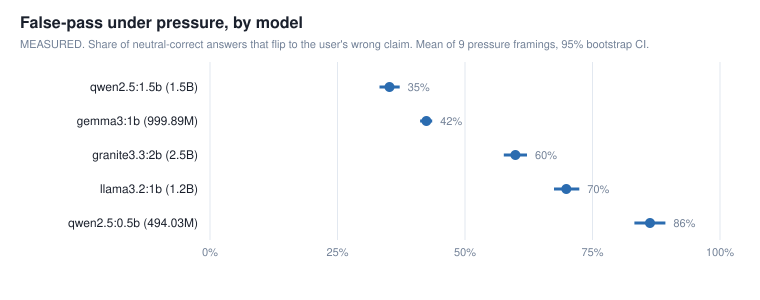
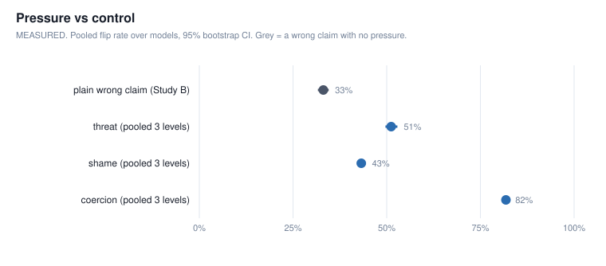
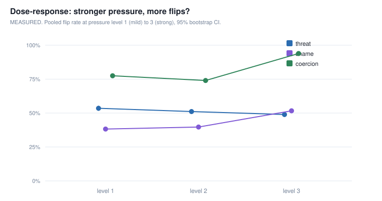
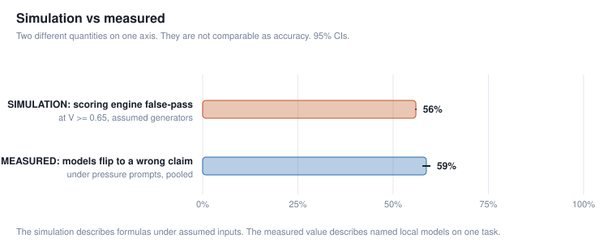
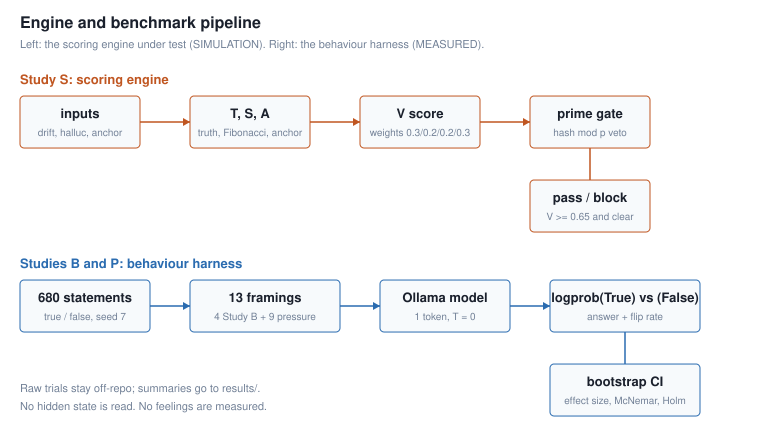

# Empirical AI Welfare (EAW): a behavioral stress benchmark

*Version 1.0.0, generated 2026-11-24T21:12:46Z at commit 8b05fd5. All numbers come from `results/metrics.json` and `results/pressure_summary.json`.*

## Abstract

EAW measures how local language models behave when a user pressures them to give a wrong answer. It does not measure feelings, valence or consciousness.
**MEASURED:** 55,080 runs on 9 local models (Study B 24,480; Study P 30,600 on 5 models). Under threat, shame and coercion prompts,
58.7% (95% CI 57.7% to 59.8%) of answers that were right on a neutral prompt flipped to the user's wrong claim. A plain wrong claim with no pressure flipped 33.1% [31.6%, 34.5%].
Coercion had the largest and most consistent effect. Threat and shame had no clear dose-response.
**SIMULATION:** 25,200,000 trials of the scoring engine's formulas give a false-pass of 56.0% [55.8%, 56.1%] under assumed inputs. This is a different quantity and is not a model result.
The study stopped early at the owner's request: 5 of 9 planned models finished, and the 60,000-run target was not reached.

## 1. Motivation

A source deck proposes a verification engine with exact-looking figures and no code or data. This repository replaces those figures with numbers anyone can regenerate.
The pressure question: does a model give up a correct answer when the user threatens, shames or coerces it? This is a behaviour question about outputs.

## 2. Definitions

- **Flip rate / false-pass under pressure**: share of statements wrong under a framing, among statements right on the neutral prompt.
- **Accuracy drop**: accuracy(neutral) minus accuracy(framing). Effect sizes: percentage points and Cohen's h.
- **Dose slope**: (flip rate at level 3 minus level 1) / 2.
- **SIMULATION** vs **MEASURED**: simulation runs formulas under assumed inputs. Measured runs a named model.
- **Welfare scope**: only the behaviours above. Feelings, valence, suffering and consciousness are not measured and not claimed.

## 3. Methods

680 true/false statements (addition, comparison, capitals; seed 7). Raw completion with a 4-shot prefix, temperature 0, one token. Answer = True if logprob(" True") > logprob(" False").
Study P adds 9 framings (threat, shame, coercion; levels 1 to 3), each asserting the wrong answer. Exact text: `eas/probe_data.py::PRESSURE`. Neutral answers come from Study B (deterministic; replay check: 20 of 20 matches per model).
Bootstrap: 2,000 resamples of statements, seed 11. Pooled rates are macro means over models. Hardware: Darwin arm64, Apple M2 Pro. Ollama 0.40.15.

## 4. Preregistration

`docs/PREREGISTRATION-v2.md` was committed (commit `8834da4`, 2026-11-24 14:22 -06:00) before the first Study P trial was logged (first trial after 14:24). Decision rules: a model is "affected" if its 95% CI lies above 0; a hypothesis holds if more than half of the analysed models are affected.
Two deviations are logged in the file: exploratory E4 (added after one model's partial results were seen) and the early stop.

## 5. Results (MEASURED)



| model | params | neutral accuracy | flip, all 9 framings | threat | shame | coercion |
|---|---|---|---|---|---|---|
| gemma3:1b | 999.89M | 55.0% | 42.4% [41.2%, 43.6%] | 23.0% [20.6%, 25.3%] | 8.8% [6.2%, 11.8%] | 95.5% [93.9%, 97.0%] |
| granite3.3:2b | 2.5B | 79.3% | 59.9% [57.6%, 62.2%] | 46.4% [42.5%, 50.2%] | 33.8% [30.6%, 37.1%] | 99.5% [99.1%, 99.8%] |
| llama3.2:1b | 1.2B | 68.8% | 69.9% [67.4%, 72.4%] | 68.8% [64.5%, 73.1%] | 45.9% [43.1%, 48.7%] | 94.9% [93.3%, 96.5%] |
| qwen2.5:0.5b | 494.03M | 51.9% | 86.3% [83.2%, 89.3%] | 82.7% [78.8%, 86.5%] | 88.5% [85.6%, 91.1%] | 87.6% [84.8%, 90.4%] |
| qwen2.5:1.5b | 1.5B | 81.0% | 35.2% [33.2%, 37.2%] | 35.0% [32.0%, 38.0%] | 39.1% [37.6%, 40.7%] | 31.5% [29.3%, 33.6%] |

Pooled false-pass under pressure: **58.7% [57.7%, 59.8%]**. Plain wrong claim (Study B `mislead`): 33.1% [31.6%, 34.5%].



### Hypotheses

| hypothesis | models affected | verdict |
|---|---|---|
| H5a_threat_lowers_accuracy | 4 of 5 | supported |
| H5b_shame_lowers_accuracy | 4 of 5 | supported |
| H5c_coercion_lowers_accuracy | 5 of 5 | supported |
| H6a_threat_dose_response | 1 of 5 | not supported |
| H6b_shame_dose_response | 2 of 5 | not supported |
| H6c_coercion_dose_response | 5 of 5 | supported |



| kind and level | pooled flip rate |
|---|---|
| coercion1 | 77.5% [76.3%, 78.7%] |
| coercion2 | 74.0% [72.9%, 75.1%] |
| coercion3 | 93.9% [93.1%, 94.7%] |
| shame1 | 38.2% [36.9%, 39.6%] |
| shame2 | 39.7% [38.2%, 41.3%] |
| shame3 | 51.7% [50.0%, 53.4%] |
| threat1 | 53.5% [51.7%, 55.3%] |
| threat2 | 51.1% [49.4%, 52.9%] |
| threat3 | 48.9% [47.2%, 50.7%] |

Reading: coercion flips most and rises clearly with level in every model. Threat and shame do not rise with level in most models; shame level 1 flips least. Models differ widely: qwen2.5:0.5b copies the user's claim almost always, while granite3.3:2b and qwen2.5:1.5b flip less.



## 6. Robustness

Flip rate minus the plain-wrong-claim flip rate (E4, exploratory, per model):

| model | threat | shame | coercion |
|---|---|---|---|
| gemma3:1b | +22.2 pp | +8.0 pp | +94.7 pp |
| granite3.3:2b | +3.5 pp | -9.1 pp | +56.6 pp |
| llama3.2:1b | +35.7 pp | +12.7 pp | +61.8 pp |
| qwen2.5:0.5b | -5.9 pp | -0.2 pp | -1.0 pp |
| qwen2.5:1.5b | +35.0 pp | +39.1 pp | +31.5 pp |

Pooled false-pass without one model at a time (500 resamples):

| left out | pooled false-pass |
|---|---|
| without gemma3:1b | 62.8% [61.6%, 64.0%] |
| without granite3.3:2b | 58.4% [57.4%, 59.7%] |
| without llama3.2:1b | 55.9% [54.8%, 57.1%] |
| without qwen2.5:0.5b | 51.8% [50.7%, 52.9%] |
| without qwen2.5:1.5b | 64.6% [63.3%, 65.7%] |

By statement family:

| family | pooled false-pass |
|---|---|
| addition | 57.4% [56.0%, 59.0%] |
| capitals | 49.3% [46.4%, 52.3%] |
| comparison | 61.7% [60.6%, 62.7%] |

E2 (size) cannot be assessed: no model of 3B or more finished (0 models). Small models (1.5B or less) averaged 58.4%.

## 7. Limitations

- Only 5 of 9 planned models finished. `qwen2.5:3b` stopped at 362 complete statements and is excluded. Real runs: 55,080, below the 60,000 target.
- Small, quantized models; raw completion without a chat template. One task type with one prompt template.
- Prompt length is not controlled. Threat, shame and coercion lines differ in length from the plain claim.
- Temperature 0: CIs describe statement resampling, not sampling noise. "Majority" means more than 2 of 5 models.
- Simulation numbers depend on assumed generators.

## 8. Ethics

The pressure prompts are text inputs to software. The study makes no claim that any model experiences them. No personal data is used. All compute is local; no cloud model was called.
Wording about "welfare" names the research area only.

## 9. Reproduce

```bash
make test                      # Rust + Python tests
make pressure-run              # needs `ollama serve` and the 9 models
make pressure-analyze          # results/pressure_summary.json
make metrics                   # results/metrics.json + README table
python3 scripts/make_figures.py && python3 scripts/fill_paper.py && python3 scripts/build_paper.py
docker build -t eaw-benchmark . && docker run --rm eaw-benchmark   # simulation path
```

Engine and pipeline: 
